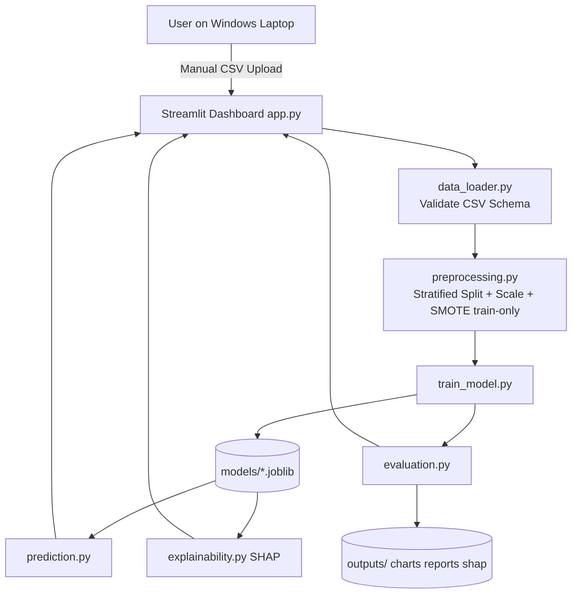
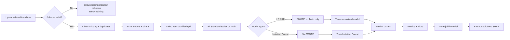
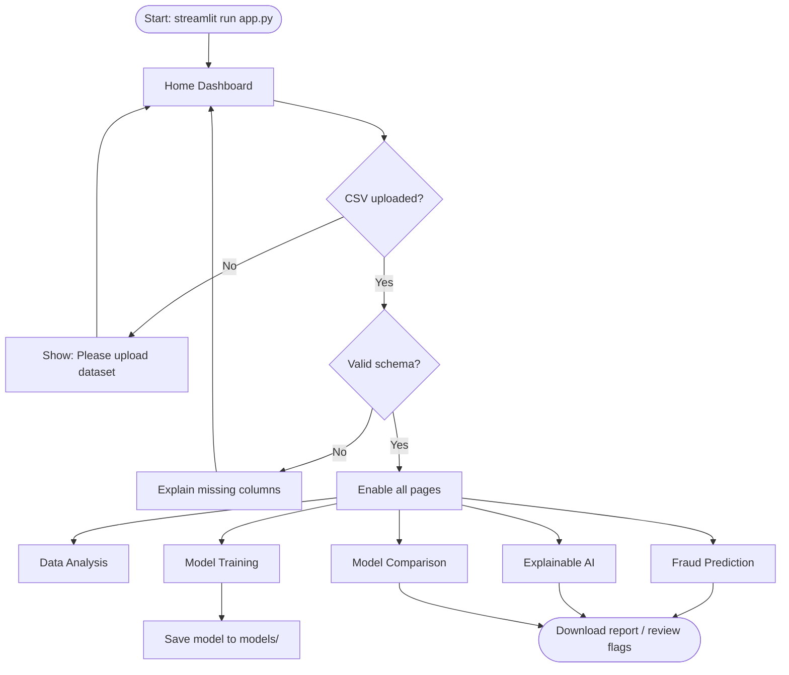
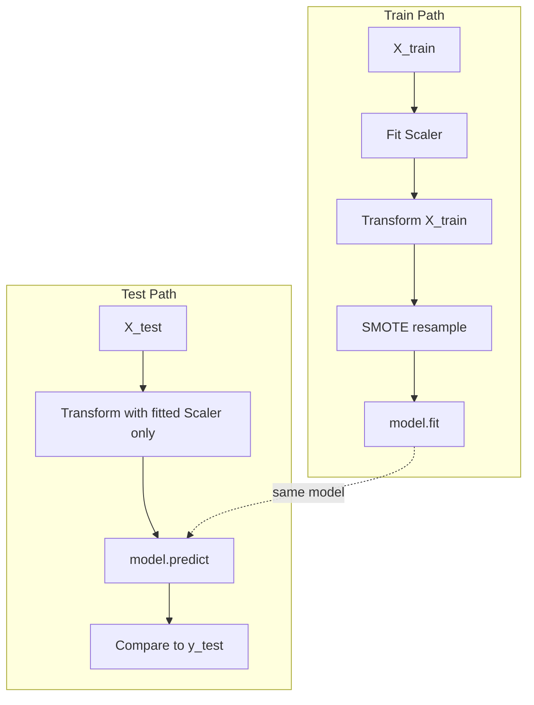

# System Diagrams

Copy these Mermaid blocks into the report, presentation, or GitHub README.
They also render on GitHub.

---

## 1. System Architecture Diagram

---

## 2. Data Flow Diagram

---

## 3. Application Flowchart

---

## 4. Train vs Test Leakage Prevention

**Rule:** Never fit the scaler on test data. Never apply SMOTE to test data.
